<div align="center">


<br>

<a href="https://creativesourcegraphics.com"></a>
<a href="https://www.linkedin.com/in/austinmperry/"></a>

</div>

---

## `$ whoami`

<p align="center">

</p>

I'm the person brands call when they need more than a developer or designer. 12+ years across ecommerce, branding, packaging, development, compliance, marketing, CRO and growth.

## `$ cat services.txt`

```yaml
services: |
  ├── Shopify and ecommerce development: fully custom Shopify themes, Shopify
  │   Functions, checkout and UI extensions, custom apps and integrations, metafields
  │   and metaobjects, performance work, Shopify CLI; WordPress, WooCommerce and
  │   Webflow builds, migrations and support
  ├── Cloud, apps and automation: Google Cloud, Firebase, AWS, custom web apps, client
  │   portals, store sync tools, MCP servers and AI tooling, Alexa and Ring
  │   integrations
  ├── Security: theme and repo security audits, secrets hygiene, access hardening
  ├── Design and packaging: branding, packaging from concept through production, FDA
  │   and Amazon label compliance, copywriting, proofreading, dielines, press-ready
  │   artwork, working directly with print manufacturers, sales collateral, trade show
  │   and digital ads, 3D product rendering
  ├── Marketing and growth: technical SEO and content, Google Shopping, analytics, UTM
  │   and pixel tracking, CRO for multiple eight-figure brands, Klaviyo,
  │   ActiveCampaign and Mailchimp flows and retention
  └── Amazon: turnkey Seller Central for FBA and FBM, listings, catalog, compliance
```

---

## `$ ls ./public-tools`

Free GitHub Actions, MIT licensed and listed on GitHub Marketplace.

<table>
<tr>
<td align="center"><a href="https://github.com/Creative-Source-Graphics-LLC/shopify-theme-changelog"></a><br><code>shopify-theme-changelog@v1</code></td>
<td align="center"><a href="https://github.com/Creative-Source-Graphics-LLC/shopify-theme-guard"></a><br><code>shopify-theme-guard@v1</code></td>
</tr>
</table>

```yaml
- uses: Creative-Source-Graphics-LLC/shopify-theme-guard@v1
```

Issues and pull requests are welcome.

---

## `$ cat stack.txt`

<p align="center">

</p>

<div align="center">

**Ecommerce**


**Code and Cloud**


**Integrations and Marketing**


</div>

---

## `$ cat partners.txt`

<div align="center">


<br>


</div>


